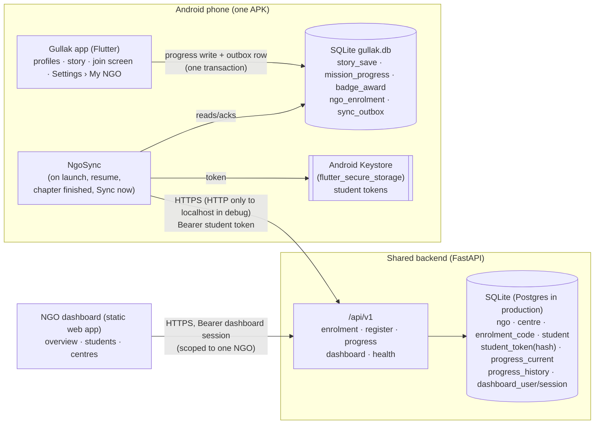

# Multi-NGO integration

The same Gullak APK serves students from any number of NGOs. A student types
their NGO's enrolment code once per local profile; from then on the app sends a
small progress summary to the backend whenever it is online, and the student
shows up on **their** NGO's dashboard automatically. The game itself stays
fully offline.

All organisations, codes, logins and students in this repository are
**fictional**. Real use needs the NGO's approval, a proper consent process
(including parents/guardians of minors), secure hosting and a privacy review.

## Architecture



Plain-text version:

```
 Phone (one APK, many profiles)                         Server (shared, multi-tenant)
 ┌──────────────────────────────────┐                  ┌──────────────────────────────┐
 │ Flutter UI ── progress write ──┐ │                  │ FastAPI /api/v1              │
 │                                ▼ │   POST register  │  enrolment / students        │
 │ SQLite: story_save, mission_…  ┌─┴─┐ POST progress  │  progress  (token → student  │
 │         ngo_enrolment          │Ngo│ ───────────────▶│            → ngo_id)         │
 │         sync_outbox  ◀── ack ──│Syn│◀─────────────── │  dashboard (session → ngo_id)│
 │ Keystore: student tokens ─────▶│c  │                 │ SQLite/Postgres              │
 └──────────────────────────────────┘                  └──────────────▲───────────────┘
                                                                       │ polls every 15 s
                                                        NGO dashboard (browser)
```

## Flow

1. **Profile** – student creates or picks a local profile (unchanged).
2. **Join screen** – shown once per profile (`profile.ngo_prompt_done`), after
   onboarding or after adding a profile. "Skip for now" is always available;
   joining later is in Settings › My NGO.
3. **Check code** – `POST /enrolment/validate`. The screen shows the NGO and
   centre so the student can confirm it, then lists what is and is not shared.
4. **Consent + Join** – the checkbox is required. The app stores
   `ngo_enrolment(status = pending, code, registration_key)` *before* calling
   `POST /students/register`, so a crash or network loss can be retried.
5. **Registered** – the server derives NGO and centre from the code, creates a
   random `STU-XXXX-XXXX` ID, and returns a separate 256-bit token (only its
   SHA-256 is stored). The app writes the token to the Keystore, marks the
   enrolment `active`, queues a first report and uploads it. The student is now
   on the dashboard ("Awaiting first sync" → "In progress").
6. **Offline enrolment** – if the phone is offline at step 3/4, the code is
   saved (`pending`) and registration happens on the next sync. The student
   cannot appear on the dashboard before that.
7. **Play** – every story checkpoint, chapter completion and progress reset
   recomputes the report inside the same SQLite transaction and upserts the
   single `sync_outbox` row for that profile if the report changed.
8. **Sync** – `NgoSync.sync()` runs on app start, on return to the foreground,
   after a finished chapter, and on "Sync now". It registers pending codes,
   uploads each profile's outbox row, deletes it only after the server
   acknowledges that revision, and handles unlinking.
9. **Dashboard** – coordinators sign in; every query is filtered by the NGO of
   the session. The page re-fetches every 15 s while visible.

## The progress report (schema v1)

Built by `lib/features/ngo/domain/progress_report.dart` from existing tables
only:

| Field | Source |
|---|---|
| `schema_version`, `student_id`, `revision`, `generated_at` | added at upload |
| `last_activity_at` | latest of `story_save.updated_at` / `mission_progress.last_played_at`, **rounded down to the hour** |
| `story.current_chapter`, `story.finished` | `story_save.state_json` |
| `chapters[]` – `id`, `completed`, `best_stars`, `plays`, `first_completed_at` | `mission_progress` (C1–C7) |
| `badges[]` | `badge_award` |
| `indicators` | decision outcomes in the saved story, **only for finished chapters**: surprise-cost choice (C1), goal and weeks saved (C2), pending-payment handling (C3), fake messages handled safely/followed and hints (C4), payment method and credit repayment (C5), fixed deposit and emergency source (C6), excluded-claim, policy choice, emergency fund (C7) |

Never sent: nickname, grade, avatar, language, money balances, the transaction
diary, raw decision logs, device details. The server rejects unknown fields
(`extra = forbid`), so extra data cannot be stored even by a modified client.

## Outbox and sync rules

- **One row per profile** (`sync_outbox.profile_id` primary key): a newer
  complete snapshot replaces the older one (coalescing).
- **Same transaction** as the progress write (`ProgressChangeHook` in
  `StoryRepository` and `ProgressRepository`), so progress and outbox never
  disagree; a failed write rolls back both.
- **No-op detection**: if the new report equals the queued one, or equals the
  last acknowledged report (`ngo_enrolment.acked_content`) with nothing queued,
  nothing is queued and the revision does not move.
- **Revision**: `ngo_enrolment.sync_revision`, monotonically increasing per
  profile; reset never lowers it.
- **Acknowledge**: deletes the row only if its revision is still the one sent;
  a newer row queued during the upload stays.
- **Retry/backoff**: offline failures don't back off (they are cheap and only
  happen on app events). Server failures (5xx, 429, TLS) back off 30 s, 1, 2, 4…
  min, max 1 h, persisted in `next_attempt_at`. "Sync now" ignores the backoff.
- **Concurrency**: one sync runs at a time; calls during a run share it and
  schedule one more pass, so double taps send nothing twice.
- **No background service**: nothing runs when the app is closed.
- **Revoked/invalid token (401)**: the enrolment becomes `revoked`, the token is
  erased, local progress is kept, and the student is asked for a new code.

## Server-side integrity

| Case | Result |
|---|---|
| New revision > current | stored as current + one history row → `accepted` |
| Same revision, same content | nothing written → `duplicate` |
| Same revision, different content | `409 revision_conflict` (+ `server_revision`); app renumbers and resends |
| Older revision | ignored → `stale` (+ `server_revision`); app renumbers above it |
| `student_id` ≠ token's student | `403 student_mismatch` |
| Retried registration (same `registration_key`) | same student, fresh token, older tokens revoked |
| Same `registration_key`, different code | `409 registration_key_conflict` |

Dashboard counts come from `progress_current` (one row per student) and the
`student` table, so retries cannot inflate them. `progress_history` has
`UNIQUE(student_id, revision)`.

## API (all under `/api/v1`)

Full schema: `backend/openapi.json` (also live at `/api/v1/docs`).
Errors are always `{"error": {"code", "message", …}}`.

| Method & path | Auth | Purpose |
|---|---|---|
| `GET /health` | – | Liveness + schema version |
| `GET /diagnostics` | – | Uptime, table counts, limits (no tenant data) |
| `POST /enrolment/validate` `{code}` | – (rate-limited) | 200 NGO + centre · 404 `code_not_found` · 410 `code_revoked` |
| `POST /students/register` `{code, registration_key, app_version}` | – (rate-limited) | 201 new / 200 replay: `student_id`, `token`, `ngo`, `centre` |
| `GET /students/me` | student token | Enrolment status, server revision |
| `DELETE /students/me` | student token | Unlink: deletes the student, history and tokens |
| `POST /progress` (report) | student token | `accepted` / `duplicate` / `stale` |
| `POST /dashboard/login` `{username, password}` | – (rate-limited) | Session token scoped to one NGO |
| `POST /dashboard/logout` | session | End session |
| `GET /dashboard/me` | session | NGO, centres, codes |
| `GET /dashboard/overview` | session | Totals, chapter completion, struggles, recent activity |
| `GET /dashboard/students?search&centre&status&sort&order&page&page_size` | session | Student table |
| `GET /dashboard/students/{id}` | session | Detail + last 20 revisions (404 for other NGOs' students) |
| `GET /dashboard/centres` | session | Per-centre counts and chapter completion |
| `GET /dashboard/activity?limit` | session | Enrolments and syncs |

Request bodies over `GULLAK_MAX_BODY_BYTES` (16 KB) get `413`. Logs contain
method, path, status and timing only — never bodies, query strings or tokens.

## Security and privacy

- **Tenant isolation**: the NGO of a student comes from the server's `student`
  row (found via the token); the NGO of a coordinator comes from their session.
  Every dashboard query filters by it, and cross-tenant lookups return 404.
- **Tokens**: random, scoped (`progress:write`), revocable, stored hashed on the
  server and in the Android Keystore on the phone; separate from the student ID.
- **No secrets in clients**: the APK contains only the API base URL (fixed at
  build time with `--dart-define=GULLAK_API_URL=…`; the student cannot change
  it). Release builds accept only `https://`; plain HTTP is allowed only to
  `10.0.2.2`/`localhost`/`127.0.0.1` in debug builds (Dart check +
  `android/app/src/debug/res/xml/network_security_config.xml`).
- **No PII by default**: no names, phone numbers or emails are collected; the
  report is minimal and schema-validated.
- **Consent**: explicit checkbox with an English/Telugu notice of what is
  shared, when, and how to stop; under-18s are told to check with a parent or
  teacher. Onboarding/About text updated in both languages.
- **Opt-out**: Settings › My NGO › Unlink. The phone stops sharing at once
  (status `unlinking`); the server deletes the student, their history and
  tokens on the next successful sync. Game progress on the phone is untouched.
  "Delete all data" also asks the server to unlink (best effort) and erases all
  tokens.
- **Retention**: the current snapshot is kept while the student is enrolled;
  history older than `GULLAK_HISTORY_RETENTION_DAYS` (default 180) is purged by
  `python -m app.admin purge-history` (schedule it daily in production);
  `delete-student` erases a student on request. NGOs should define and publish
  their own retention period in the consent notice.

## Local demo (end to end)

Ports: API **8787**, dashboard **5173**. Commands from the repo root.

```bash
# 1. Backend (fresh demo database)
cd backend && python3 -m venv .venv && .venv/bin/pip install -r requirements-dev.txt
rm -f data/gullak.db* && .venv/bin/python -m app          # leave running

# 2. Dashboard (second terminal)
python3 -m http.server 5173 --bind 127.0.0.1 -d ngo-dashboard
#    open http://127.0.0.1:5173 → pick Green Futures Foundation → Sign in
#    (empty state: "No students yet")

# 3. App on the emulator (third terminal)
flutter build apk --debug && adb install -r build/app/outputs/flutter-apk/app-debug.apk
#    physical phone over USB instead:  adb reverse tcp:8787 tcp:8787  and build with
#    --dart-define=GULLAK_API_URL=http://localhost:8787
```

4. In the app: English → I understand → nickname "Asha" → Easy → enter
   `NGO-HYD-001` → Check code (shows Green Futures Foundation · Ameerpet) →
   tick the consent → Join. The map shows "Synced just now".
5. Settings › Switch or add profile › Add a new profile → "Ravi" → Easy →
   `NGO-VJA-001` → consent → Join.
6. Green Futures' dashboard shows Asha's student ID within 15 s; sign out and
   sign in as Youth Finance Collective — only Ravi is there; Udaan is empty.
7. Switch back to Asha. Turn on airplane mode. Play chapter 1 to the end.
   The map says "Offline · saved on phone"; progress is in `sync_outbox`
   (inspect: `adb shell run-as org.megathon.gullak.gullak cat databases/gullak.db > dev.db`).
8. Turn airplane mode off, press Home, reopen Gullak. The app syncs on resume;
   the map says "Synced just now" and the dashboard shows 1 of 7 chapters,
   3 stars and the Budget Planner badge at its next refresh — no clicks.
9. Settings › My NGO › tap "Sync now" repeatedly: `/api/v1/diagnostics`
   still shows the same `student` and `progress_history` counts.
10. Optional: `backend/.venv/bin/python backend/scripts/simulate_students.py`
    adds fictional students through the public API to fill the dashboard.

This exact sequence (steps 1–9) was run on the `gullak_test` emulator (API 35)
during development.

## Tests

| Suite | Covers |
|---|---|
| `backend/tests/test_enrolment.py` | valid/unknown/revoked codes, registration idempotency + token rotation, key reuse with another code, three NGOs, missing/invalid/revoked tokens, unlink, unknown fields, rate limit, body limit, health |
| `backend/tests/test_progress.py` | newer/duplicate/older/conflicting revisions, no duplicate history, token for another student, NGO can't be injected, report validation, revoked token |
| `backend/tests/test_dashboard.py` | sign-in required, logout, empty dashboard, **new student appears automatically on the right dashboard only**, cross-NGO detail/search/filter/activity, aggregate correctness, inactive/completed filters, sorting, paging, detail + history |
| `backend/tests/test_operations.py` | adding an NGO with only backend rows, revoking a code, history retention |
| `test/ngo/progress_report_test.dart` | report content (no balances/PII), indicators only after finished chapters, payload |
| `test/ngo/outbox_test.dart` | queued only when linked, same transaction/rollback, coalescing, no-op skip, ack of older revision, reset, backoff, **persistence across restart**, **v4 → v5 migration keeps saved progress** |
| `test/ngo/ngo_sync_test.dart` | join, invalid/revoked codes, offline join, lost registration reply, offline play then upload, server failure + retry, Sync now, concurrent syncs, stale revision, revoked token, **two profiles → two NGOs independently**, unlink, restart |
| `test/widget/ngo_flow_test.dart` | join screen with consent through the real UI, offline save, Telugu skip |
| `test/e2e/backend_e2e_test.dart` | the app's real sync code against the real Python server: two NGOs, offline then online, retry = duplicate, cross-tenant 404, unlink |
| `integration_test/ngo_sync_test.dart` | on device: enrol via UI with real Keystore + HTTP, play chapter 1, check the dashboard API |

## Hosting

`render.yaml` deploys the API, the dashboard (served by the API at `/`) and a
PostgreSQL database on Render's free plan; steps in `backend/README.md`. The
deployment runs with `GULLAK_ENV=production`: no public demo passwords
(Render generates them), HTTPS only, the fictional NGOs and codes seeded, and
client addresses taken from the proxy for rate limiting. The backend runs the
same test suite on SQLite and PostgreSQL.

## Production requirements (not done in the prototype)

- Release signing; a custom domain if the Render URL is not acceptable.
- A paid/persistent PostgreSQL (the free Render database expires after 30
  days) and a shared rate-limit store if several API workers run.
- Real dashboard accounts per staff member (invites, password reset, MFA,
  roles), HttpOnly cookie sessions, audit log.
- Consent process agreed with each NGO, including guardians of minors;
  privacy review; published retention period; scheduled `purge-history`.
- Monitoring/alerting; backups with the same retention rules.
- Fluent review of the new Telugu strings (below).
- Dashboard internationalisation if coordinators need Telugu.

## New Telugu strings (unreviewed)

All `ngo_*`, `sync_*` and `time_*` keys in `assets/content/translations/te.json`,
plus the changed `notice_point_offline` and `about_body`, were written without a
fluent-speaker review.
