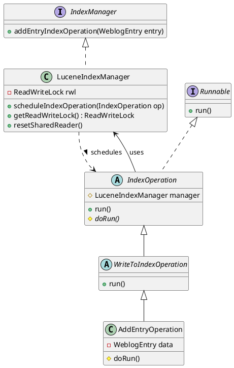
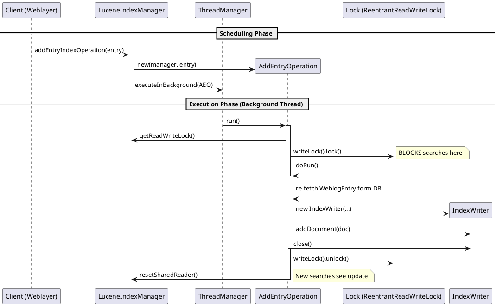

# LLM Prompt Used

``` 

Task 1: 

Apache Roller is an open-source, Java-based blog platform. It supports multi-user blogging, group blogs, comment moderation, and content indexing via Lucene.

Search and Indexing Subsystem: Centered around the Lucene-based search functionality that allows users to comb through blog content.

Take small, clearly defined part of the above subsystem(Search and Indexing) and complete the below task (create an md for the response)

Task Description:

Identify Relevant Classes: Discern the key Java classes and interfaces responsible for the three subsystems mentioned above.

Document Functionality: Create detailed documentation for each identified class, explaining its role and how it interacts with the rest of the subsystem.

Create UML Diagrams: Use PlantUML or StarUML to model the relationships (inheritance, association, composition, etc.).

Observations and Comments: Highlight strengths and weaknesses of the current design.

Assumptions: Explicitly state any simplifications you made while modeling.

```

# Apache Roller Search Subsystem Analysis: Index Modification

## 1. Selected Subsystem Part: Index Modification

This analysis focuses on the specific mechanism used to **add entries to the search index**. This is a critical writer-side operation that ensures blog posts are discoverable. It involves scheduling background tasks, managing concurrency with locks, and interfacing with Apache Lucene.

## 2. Relevant Classes

The following classes orchestrate the adding of a Weblog Entry to the Lucene Index:

### 1. `IndexManager`
*   **Package**: `org.apache.roller.weblogger.business.search`
*   **Type**: Interface
*   **Role**: The public API for the search subsystem. It defines the contract for operations like `addEntryIndexOperation`, effectively hiding the underlying Lucene implementation from the rest of the Roller application.

### 2. `LuceneIndexManager`
*   **Package**: `org.apache.roller.weblogger.business.search.lucene`
*   **Type**: Class (Singleton)
*   **Role**: The concrete coordinator.
    *   It maintains the lifecycle of the Lucene `IndexReader`.
    *   It holds the **ReadWriteLock** (`ReentrantReadWriteLock`) used to synchronize access to the index files.
    *   It acts as a factory/dispatcher, creating specific operation objects (like `AddEntryOperation`) and handing them off to the `ThreadManager` for background execution.

### 3. `IndexOperation`
*   **Package**: `org.apache.roller.weblogger.business.search.lucene`
*   **Type**: Abstract Class
*   **Role**: Represents a generic task involving the index. It implements `Runnable`, allowing it to be executed asynchronously. It holds a reference to the `LuceneIndexManager`.

### 4. `WriteToIndexOperation`
*   **Package**: `org.apache.roller.weblogger.business.search.lucene`
*   **Type**: Abstract Class
*   **Role**: A specialized operation for **modifying** the index (writing).
    *   **Key Responsibility**: It encapsulates the concurrency logic. In its `run()` method, it acquires the **Write Lock** from the manager before calling the abstract `doRun()` method, and releases it in a `finally` block. It also triggers a reset of the shared index reader to ensure future searches see the fresh data.

### 5. `AddEntryOperation`
*   **Package**: `org.apache.roller.weblogger.business.search.lucene`
*   **Type**: Class
*   **Role**: The concrete command to add a specific `WeblogEntry`.
    *   It re-fetches the `WeblogEntry` from the database (to avoid detached object issues).
    *   It converts the entry content into a Lucene `Document`.
    *   It performs the actual `indexWriter.addDocument()` call.

---

## 3. UML Diagrams

### Class Diagram (PlantUML)

The following diagram illustrates the Command Pattern structure used for index operations.



### Sequence Diagram: Adding an Entry (PlantUML)

This diagram portrays the asynchronous flow of adding an entry. Note the separation between the client thread (scheduling) and the background thread (execution/locking).



---

## 4. Observations and Comments

### Strengths
1.  **Asynchronous processing**: The `addEntryIndexOperation` returns immediately. The heavy cost of I/O and text analysis (tokenization) happens in a background thread, ensuring the user interface remains responsive when saving a blog post.
2.  **Safety via Detachment**: `AddEntryOperation` explicitly re-queries the `WeblogEntry` from the database. This is a robust pattern when dealing with objects passed between threads, preventing Hibernate/JPA "LazyInitializationException" or stale data issues.
3.  **Strict Concurrency Control**: The use of `WriteToIndexOperation` as a base class ensures that *every* write operation enforces the locking layer. Developers cannot easily forget to lock the index when adding a new type of write operation.

### Weaknesses
1.  **Global Write Lock**: Closely coupled with Lucene's historical restrictions, the system uses a coarse-grained mechanism where *one* writer blocks *all* readers. If `AddEntryOperation` takes a long time (e.g., large content or slow I/O), searching the website will hang for all users until it completes.
2.  **Resource Contention**: In a high-volume environment with many concurrent posts/comments, the background threads could pile up waiting for the single write lock, potentially exhausting the `ThreadManager` pool.
3.  **No Retry Mechanism**: If the `doRun()` fails (e.g., lock acquisition error or IO exception), the operation is logged as an error and dropped. There is no visible queue or mechanism to retry failed index updates.

## 5. Assumptions

1.  **ThreadManager Implementation**: We assume the `ThreadManager` provided by the Roller instance correctly manages a thread pool and executes tasks relatively promptly.
2.  **Single-Node Deployment**: The `ReentrantReadWriteLock` is a JVM-level lock. This design assumes the application is running on a single server or that the Lucene index is local to each node. If the index is on a shared network drive accessed by multiple Roller nodes, this locking mechanism is insufficient and would lead to corruption.
3.  **Database Availability**: It is assumed the database is up and the entry still exists when the background task starts; otherwise, `doRun` returns (as seen in `AddEntryOperation.java` lines 67-73).
