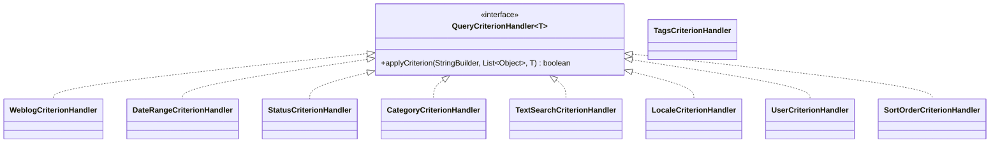

# Refactoring Report 

# Weblog and Content Subsystem

## 1. Insufficient Modularization (God Class)

### Problem
Two classes in the Weblog and Content Subsystem were identified as "God Classes" with too many responsibilities:

- **`JPAWeblogEntryManagerImpl`**: ~1400 lines handling multiple unrelated concerns:
  - WeblogEntry CRUD operations
  - WeblogCategory management (8 methods)
  - WeblogComment management (8 methods)
  - WeblogHitCount tracking (8 methods)
  - Tag management (4 methods)

- **`JPAWeblogManagerImpl`**: ~720 lines handling:
  - Weblog CRUD operations
  - WeblogTemplate management (8 methods)

This violated the **Single Responsibility Principle (SRP)** making these classes hard to maintain and test. SonarQube reported high Cognitive Complexity scores for several methods.

### Solution
We extracted cohesive groups of methods into five new focused service classes:

- **`WeblogCategoryService`** / **`JPAWeblogCategoryServiceImpl`**: Handles category operations (`saveWeblogCategory`, `removeWeblogCategory`, `moveWeblogCategoryContents`, `getWeblogCategory`, `getWeblogCategoryByName`, `getWeblogCategories`, `isDuplicateWeblogCategoryName`, `isWeblogCategoryInUse`).

- **`WeblogCommentService`** / **`JPAWeblogCommentServiceImpl`**: Handles comment operations (`saveComment`, `removeComment`, `getComment`, `getComments`, `removeMatchingComments`, `getMostCommentedWeblogEntries`, `getCommentCount`).

- **`WeblogHitCountService`** / **`JPAWeblogHitCountServiceImpl`**: Handles hit count tracking (`getHitCount`, `getHitCountByWeblog`, `getHotWeblogs`, `saveHitCount`, `removeHitCount`, `incrementHitCount`, `resetAllHitCounts`, `resetHitCount`).

- **`WeblogTagService`** / **`JPAWeblogTagServiceImpl`**: Handles tag management (`getPopularTags`, `getTags`, `getTagComboExists`, `updateTagCount`).

- **`WeblogTemplateService`** / **`JPAWeblogTemplateServiceImpl`**: Handles template operations (`saveTemplate`, `saveTemplateRendition`, `removeTemplate`, `getTemplate`, `getTemplateByLink`, `getTemplateByAction`, `getTemplateByName`, `getTemplates`).

### Benefit
- **`JPAWeblogEntryManagerImpl`** reduced from ~1400 to ~920 lines (~35% reduction)
- **`JPAWeblogManagerImpl`** reduced from ~720 to ~660 lines (~8% reduction)
- Each new service class has a clear, single purpose and can be tested independently
- The existing public APIs (`WeblogManager`, `WeblogEntryManager`) remain unchanged through delegation, ensuring backward compatibility

---

### Files Changed

### New Files Created
| File                                | Purpose                                        |
| ----------------------------------- | ---------------------------------------------- |
| `WeblogCategoryService.java`        | Interface for category management (8 methods)  |
| `JPAWeblogCategoryServiceImpl.java` | JPA implementation of WeblogCategoryService    |
| `WeblogCommentService.java`         | Interface for comment management (8 methods)   |
| `JPAWeblogCommentServiceImpl.java`  | JPA implementation of WeblogCommentService     |
| `WeblogHitCountService.java`        | Interface for hit count management (8 methods) |
| `JPAWeblogHitCountServiceImpl.java` | JPA implementation of WeblogHitCountService    |
| `WeblogTagService.java`             | Interface for tag management (4 methods)       |
| `JPAWeblogTagServiceImpl.java`      | JPA implementation of WeblogTagService         |
| `WeblogTemplateService.java`        | Interface for template management (8 methods)  |
| `JPAWeblogTemplateServiceImpl.java` | JPA implementation of WeblogTemplateService    |

### Modified Files
| File                             | Changes                                                                 |
| -------------------------------- | ----------------------------------------------------------------------- |
| `JPAWebloggerModule.java`        | Added Guice bindings for all 5 new services                             |
| `JPAWeblogEntryManagerImpl.java` | Injects 4 services and delegates; reduced from ~1400 to ~920 lines      |
| `JPAWeblogManagerImpl.java`      | Injects template service and delegates; reduced from ~720 to ~660 lines |

---

## 2. Missing Hierarchy (High Cognitive Complexity)

### Problem
SonarQube flagged high Cognitive Complexity in two key methods with branch-heavy conditional logic:

**JPAWeblogManagerImpl.java**
- Rule: java:S3776
- Severity: CRITICAL
- Message: Refactor this method to reduce its Cognitive Complexity from 21 to the 15 allowed.

**JPAWeblogEntryManagerImpl.java**
- Rule: java:S3776
- Severity: CRITICAL
- Message: Refactor this method to reduce its Cognitive Complexity from 18 to the 15 allowed.

The root cause is **missing hierarchy** - behavior variants for building dynamic queries (by date, status, category, tags, text, etc.) were handled through sequences of if-statements rather than polymorphism.

### Solution: Strategy Pattern for Query Building

Introduced a hierarchy of `QueryCriterionHandler` strategies that each handle one aspect of query building:

**Query Builders** orchestrate the handlers:
- `WeblogEntryQueryBuilder` - Uses handlers to build WeblogEntry queries
- `WeblogQueryBuilder` - Uses handlers to build Weblog queries

### Benefit
- **Cognitive Complexity Reduced**:
  - `getWeblogEntries()`: Reduced from ~18 to ~5
  - `getWeblogs()`: Reduced from ~21 to ~5
- **Open/Closed Principle**: New search criteria can be added without modifying existing code
- **Testability**: Each handler can be unit tested in isolation
- **Maintainability**: Query logic is now encapsulated in focused, single-responsibility classes

---

### Files Changed

### New Files Created
| File                              | Purpose                                         |
| --------------------------------- | ----------------------------------------------- |
| `QueryCriterionHandler.java`      | Strategy interface for query criteria handling  |
| `WeblogCriterionHandler.java`     | Handles weblog filtering criterion              |
| `DateRangeCriterionHandler.java`  | Handles start/end date filtering                |
| `StatusCriterionHandler.java`     | Handles entry status filtering                  |
| `CategoryCriterionHandler.java`   | Handles category filtering                      |
| `LocaleCriterionHandler.java`     | Handles locale filtering                        |
| `TextSearchCriterionHandler.java` | Handles text search in title/text/summary       |
| `UserCriterionHandler.java`       | Handles author/user filtering                   |
| `SortOrderCriterionHandler.java`  | Handles sort by/order clauses                   |
| `WeblogEntryQueryBuilder.java`    | Builder that orchestrates entry query handlers  |
| `WeblogQueryBuilder.java`         | Builder that orchestrates weblog query handlers |

### Modified Files
| File                             | Changes                                                          |
| -------------------------------- | ---------------------------------------------------------------- |
| `JPAWeblogEntryManagerImpl.java` | Refactored `getWeblogEntries()` to use `WeblogEntryQueryBuilder` |
| `JPAWeblogManagerImpl.java`      | Refactored `getWeblogs()` to use `WeblogQueryBuilder`            |
---

---

# User and Role Management Subsystem

## 1. Insufficient Modularization (God Class)

### Problem
The `UserManager` interface and its implementation `JPAUserManagerImpl` were "God Classes" with 631 lines and 34 methods, handling too many unrelated responsibilities:
- User CRUD operations
- Role assignment and management
- WeblogPermission management
- User queries, filters and paging

This violated the **Single Responsibility Principle (SRP)**, making the class hard to maintain and test.

### Solution
We extracted different responsibilities into separate manager interfaces and implementations:

**`UserManager`** - Now handles only User CRUD operations:
- `addUser(User user)`
- `saveUser(User user)`
- `removeUser(User user)`

**`UserQueryManager`** - Handles all user query and lookup operations:
- `getUser(String id)`
- `getUserByUserName(String userName)`
- `getUserByUserName(String userName, Boolean enabled)`
- `getUserByOpenIdUrl(String openIdUrl)`
- `getUsers(Boolean enabled, Date startDate, Date endDate, int offset, int length)`
- `getUsersStartingWith(String startsWith, Boolean enabled, int offset, int length)`
- `getUserNameLetterMap()`
- `getUsersByLetter(char letter, int offset, int length)`
- `getUserCount()`
- `getUserByActivationCode(String activationCode)`

**`RoleManager`** - Handles role-related operations:
- `grantRole(String roleName, User user)`
- `revokeRole(String roleName, User user)`
- `hasRole(String roleName, User user)`
- `getRoles(User user)`

**`PermissionManager`** - Handles all WeblogPermission operations:
- `checkPermission(RollerPermission perm, User user)`
- `getWeblogPermission(Weblog weblog, User user)`
- `getWeblogPermissions(User user)`
- `getWeblogPermissions(Weblog weblog)`
- `getWeblogPermissionsIncludingPending(Weblog weblog)`
- `getPendingWeblogPermissions(User user)`
- `grantWeblogPermission(Weblog weblog, User user, List<String> actions)`
- `grantWeblogPermission(Weblog weblog, User user, List<String> actions, WeblogPermission.PermissionStatus status)`
- `confirmWeblogPermission(Weblog weblog, User user)`
- `declineWeblogPermission(Weblog weblog, User user)`
- `revokeWeblogPermission(Weblog weblog, User user, List<String> action)`
- `getWeblogPermissionsByStatus(Weblog weblog, WeblogPermission.PermissionStatus status)`
- `getWeblogPermissionsByUserAndStatus(User user, WeblogPermission.PermissionStatus status)`

### Benefit
`UserManager` is now reduced to only 3 CRUD methods. Each new manager has a clear, single purpose and can be tested independently. This refactoring successfully eliminated the "Insufficient Modularization" design smell.

---

## 2. Missing Abstraction

### Problem
The `UserManager` class encapsulated multiple distinct domain concepts without proper abstraction boundaries:
- **User lifecycle management** — CRUD operations for users
- **Role management** — Granting/revoking roles to users
- **Permission evaluation** — Checking user permissions
- **User querying** — Looking up and filtering users

These concepts were all bundled into a single `UserManager` interface, meaning no explicit abstractions existed to represent them individually. Designite reported this as a "Missing Abstraction" smell, indicating that important domain concepts were not modeled as separate abstractions.

### Relationship with Insufficient Modularization
This smell overlaps with the Insufficient Modularization smell addressed above. The extractions performed to resolve that smell also introduce the missing abstractions for each domain concept.

### Benefit
Each domain concept now has its own dedicated abstraction with a clear, single purpose:

| Domain Concept | Abstraction | Methods |
|----------------|-------------|---------|
| User Lifecycle | `UserManager` | 3 |
| User Querying | `UserQueryManager` | 10 |
| Role Management | `RoleManager` | 4 |
| Permission Evaluation | `PermissionManager` | 13 |

The system now has clear abstraction boundaries, making it easier to understand the domain model, test components independently, and modify one concern without affecting others. This refactoring successfully eliminated the "Missing Abstraction" design smell.

---

### Files Changed ( Combined for both smells )

### New Files Created
| File | Purpose |
|------|---------|
| `RoleManager.java` | Interface for role management (4 methods) |
| `JPARoleManagerImpl.java` | JPA implementation of RoleManager |
| `PermissionManager.java` | Interface for permission management (13 methods) |
| `JPAPermissionManagerImpl.java` | JPA implementation of PermissionManager |
| `UserQueryManager.java` | Interface for user query operations (10 methods) |
| `JPAUserQueryManagerImpl.java` | JPA implementation of UserQueryManager |
| `WeblogMembershipManager.java` | Interface for weblog membership (12 methods) |
| `JPAWeblogMembershipManagerImpl.java` | JPA implementation of WeblogMembershipManager |

### Modified Files
| File | Changes |
|------|---------|
| `UserManager.java` | Reduced from 30 methods to 3 CRUD methods |
| `JPAUserManagerImpl.java` | Reduced from 631 to ~108 lines |
| `Weblogger.java` | Added `getRoleManager()`, `getPermissionManager()`, `getUserQueryManager()`, `getWeblogMembershipManager()` |
| `WebloggerImpl.java` | Added new manager fields and getter implementations |
| `JPAWebloggerImpl.java` | Updated constructor to accept new managers |
| `JPAWebloggerModule.java` | Added Guice bindings for new managers |

---
--- 

# Search and Indexing Subsystem

## 1. Insufficient Modularization (God Class)

### Problem
The `LuceneIndexManager` class was a "God Class," assuming too many responsibilities:
- Index lifecycle management (creation, deletion, checking consistency).
- Lucene Analyzer configuration.
- Search result conversion.
- Execution of index operations.

This violated the **Single Responsibility Principle (SRP)**, making the class hard to maintain and test.

### Solution
We extracted different responsibilities into helper classes:
- **`LuceneIndexSetup`**: Handles index directory management, initialization logic, and consistency checks.
- **`LuceneAnalyzerFactory`**: Encapsulates the configuration and creation of Lucene Analyzers.
- **`LuceneResultConverter`**: Converts raw Lucene `ScoreDoc` hits into the application's `WeblogEntry` objects.

### Benefit
`LuceneIndexManager` is now smaller and focuses on its primary role: coordinating high-level index operations. Each new class has a clear, single purpose.

**Files Changed (Insufficient Modularization)**

| File                         | Status       | Purpose                                                |
| ---------------------------- | ------------ | ------------------------------------------------------ |
| `LuceneIndexSetup.java`      | **NEW**      | Handles index directory management and initialization. |
| `LuceneAnalyzerFactory.java` | **NEW**      | Encapsulates Lucene Analyzer configuration.            |
| `LuceneResultConverter.java` | **NEW**      | Converts Lucene hits into Roller domain objects.       |
| `LuceneIndexManager.java`    | **MODIFIED** | Delegated responsibilities to the new helper classes.  |

---

## 2. Imperative Abstraction

### Problem
The subsystem contained multiple classes that represented single actions rather than domain objects:
- `AddEntryOperation`
- `RemoveEntryOperation`
- `ReIndexEntryOperation`
- `RebuildWebsiteIndexOperation`
- `RemoveWebsiteIndexOperation`
- `WriteToIndexOperation`
- `ReadFromIndexOperation`
- `IndexOperation`

These classes had little behavioral identity (an "anti-pattern" where classes are just functions wrapped in objects) and bloated the package structure.

### Solution
We combined these operations into a single service and a factory:
- **`LuceneOperations`**: A cohesive service class that contains methods for all write operations (`addEntry`, `removeEntry`, etc.).
- **`LuceneDocumentFactory`**: A utility class responsible for converting `WeblogEntry` domain objects into Lucene `Document` objects.
- **Deleted**: The 8 individual operation classes were removed.

### Benefit
The code is more organized and easier to navigate. Related operations are grouped together, reducing class explosion and improving cohesion.

**Files Changed (Imperative Abstraction)**

| File                                | Status       | Purpose                                              |
| ----------------------------------- | ------------ | ---------------------------------------------------- |
| `LuceneOperations.java`             | **NEW**      | Service class consolidating all write operations.    |
| `LuceneDocumentFactory.java`        | **NEW**      | Logic for converting WeblogEntry to Lucene Document. |
| `AddEntryOperation.java`            | **DELETED**  | Consolidated into `LuceneOperations`.                |
| `RemoveEntryOperation.java`         | **DELETED**  | Consolidated into `LuceneOperations`.                |
| `ReIndexEntryOperation.java`        | **DELETED**  | Consolidated into `LuceneOperations`.                |
| `RebuildWebsiteIndexOperation.java` | **DELETED**  | Consolidated into `LuceneOperations`.                |
| `RemoveWebsiteIndexOperation.java`  | **DELETED**  | Consolidated into `LuceneOperations`.                |
| `WriteToIndexOperation.java`        | **DELETED**  | Replaced by centralized logic.                       |
| `ReadFromIndexOperation.java`       | **DELETED**  | Replaced by centralized logic.                       |
| `IndexOperation.java`               | **DELETED**  | Base class no longer needed.                         |
| `LuceneIndexManager.java`           | **MODIFIED** | Updated to use the new unified service.              |
| `SearchOperation.java`              | **MODIFIED** | Refactored to remove command pattern dependency.     |

---

## 3. Leaky Encapsulation

### Problem
`LuceneIndexManager` exposed internal implementation details to its clients:
- `getReadWriteLock()`
- `getSharedIndexReader()`
- `getIndexDirectory()`

Consumers (like the old operation classes) had to manually acquire locks and manage low-level Lucene resources (Readers/Writers), leading to potential concurrency errors and tight coupling.

### Solution
We encapsulated these resources within `LuceneIndexManager` by introducing high-level execution methods:
- **`executeWrite(IndexWriterConsumer)`**: Handles write lock acquisition, `IndexWriter` creation/closing, and safely executes the provided logic.
- **`executeSearch(IndexSearcherConsumer)`**: Handles read lock acquisition, `IndexSearcher` creation from the shared reader, and safely executes the search.
- **Hiding Internals**: The getters for locks, readers, and directories were made private or removed.

### Benefit
Client code (e.g., `LuceneOperations`, `SearchOperation`) no longer worries about resource management or concurrency control. The risk of deadlocks or unclosed resources is significantly reduced, and the internal implementation of the index manager can be changed without affecting clients.

**Files Changed (Leaky Encapsulation)**

| File                      | Status       | Purpose                                                        |
| ------------------------- | ------------ | -------------------------------------------------------------- |
| `LuceneIndexManager.java` | **MODIFIED** | Made internal fields/methods private; added execution methods. |
| `LuceneOperations.java`   | **MODIFIED** | Updated to use the new `executeWrite` API.                     |
| `SearchOperation.java`    | **MODIFIED** | Updated to use the new `executeSearch` API.                    |

---