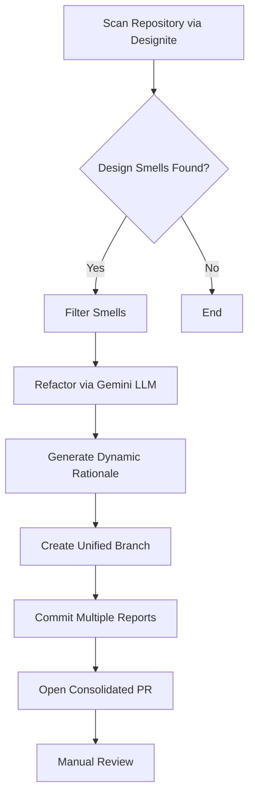

# Task 3C: Automating the Refactoring Pipeline using LLMs

## Overview
This automated pipeline leverages **DesigniteJava** to detect professional-grade design smells in Java code, generates refactored suggestions using LLMs (Gemini), and creates consolidated Pull Requests containing detailed refactoring reports.

## Pipeline Flowchart

The following flowchart shows the end-to-end process:

## Python Modules

### 1. Detection (`detect_smells.py`)
- **Designite Integration**: The pipeline executes the **DesigniteJava** analysis tool for deep architectural inspection.
- **Priority Filtering**: Scans specifically for high-impact smells (e.g., *Broken Hierarchy*, *Insufficient Modularization*, *Imperative Abstraction*) to ensure the LLM focuses on significant design improvements.
- **Automated Cleanup**: Generates and parses the `DesignSmells.csv` report on the fly, with automatic cleanup of temporary data.

### 2. Refactoring (`refactor_code.py`)
- **Multi-File Context**: Supports refactorings involving multiple files or splitting single classes into multiple modular components.
- **Prompting**: Uses specialized prompts to guide the LLM in handling complex architectural smells with context across the identified design issues.
- **Dynamic Rationale**: Every suggested change includes a specific **"Metrics & Rationale"** section generated by the LLM, explaining the technical "why" behind the refactoring.

### 3. PR Generation (`create_pr.py`)
- Uses the GitHub REST API to interact with the repository securely.
- **Consolidated PRs**: To reduce noise, all reports generated in a single run are committed to **one single branch** and linked in **one consolidated Pull Request**.
- **Safety**: No code files are modified directly. Reports are pushed as Markdown files to the `docs/Task - 3/Task - 3C/` directory.

### 4. Integration (`pipeline.py`)
- **Randomized Selection**: Shuffles the detected smells list before processing to ensure diverse coverage across various modules in different runs.
- **Unified Reporting**: Aggregates findings into a single, comprehensive Pull Request containing multiple detailed Markdown reports.
- **Rate Limiting Problem**: Maintains a 20-second delay between LLM calls to respect the "Requests Per Minute" limits of the free tier.

## Automation & Periodic Scanning

The pipeline is fully automated using **GitHub Actions**:
- **Periodic**: Runs every **Sunday at 00:00 UTC**.
- **Event-driven**: Runs automatically on every **Push** to the `master` branch.
- **Manual**: Can be triggered via the **Actions** tab using `workflow_dispatch`.

## Refactoring Report Structure
Each consolidated Pull Request contains reports with:
- **Detected Smell**: Precise type and location.
- **Before/After**: Comparative Java code blocks showing recommended improvements.
- **Metrics & Rationale**: AI-generated reasoning tailored to the specific code change, focusing on reduced cyclomatic complexity and improved maintainability.
